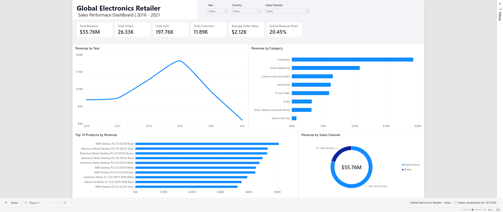

# Global Electronics Retailer Sales Analysis



## Project Overview

This project analyzes sales data from a global electronics retailer to identify
revenue trends, product performance, sales-channel distribution, seasonality,
and geographic patterns.

The data was cleaned, transformed, and analyzed using Python and Pandas.
An interactive dashboard was then developed in Power BI to present the main
business indicators and insights.

The project covers sales data from 2016 to February 2021.

> Note: 2021 contains only partial data through February 20, 2021 and should
> not be directly compared with complete years.

---

## Business Questions

The analysis was designed to answer the following questions:

- How did revenue evolve over time?
- Which product categories generate the most revenue?
- Which products perform best in terms of revenue and units sold?
- Are there seasonal patterns in sales?
- How does online revenue compare with physical-store revenue?
- Which countries and physical stores generate the most revenue?

---

## Tools and Technologies

- Python
- Pandas
- Matplotlib
- Jupyter Notebook
- Power BI
- DAX
- Git
- GitHub

---

## Dataset

The project uses the Global Electronics Retailer dataset.

The original dataset contains information about:

- Sales
- Products
- Stores
- Customers
- Exchange rates

A data dictionary is also included in the `docs` directory.

The main datasets used in the analysis were:

- `Sales.csv`
- `Products.csv`
- `Stores.csv`

The processed dataset used in Power BI is available at:

`data/processed/sales_cleaned.csv`

---

## Data Preparation

The main data preparation steps included:

- Inspection of dataset structure and data types
- Missing-value analysis
- Duplicate validation
- Date conversion
- Product data cleaning
- Store data integration
- Sales and product table joins
- Revenue calculation
- Creation of year and month variables
- Identification of online and physical-store sales
- Export of the cleaned dataset for Power BI

The final analytical dataset contains approximately 62,000 sales line items.

---

## Key Metrics

| Metric | Value |
|---|---:|
| Total Revenue | $55.76M |
| Total Orders | 26.33K |
| Units Sold | 197.76K |
| Unique Customers | 11.89K |
| Average Order Value | $2.12K |
| Online Revenue Share | 20.45% |

---

## Key Insights

### Revenue Trend

Revenue increased between 2016 and 2019, reaching its highest level in 2019.

A significant decline was observed in 2020.

The 2021 result represents only a partial year and should therefore not be
directly compared with previous full-year results.

### Product Categories

Computers generated the highest revenue among all product categories, followed
by Home Appliances.

Games and Toys generated the lowest revenue during the analyzed period.

### Product Performance

Desktop computers dominated the ranking of highest-revenue products.

The analysis also showed that products with lower sales volume can still
generate significant revenue when their unit price is substantially higher.

### Seasonality

Using only complete years from 2016 to 2020, December generated the highest
accumulated revenue.

February and January also performed strongly, while March and especially April
showed weaker results.

### Sales Channels

Physical stores accounted for approximately 79.55% of total revenue.

Online sales represented approximately 20.45% of total revenue.

This indicates that physical retail remained the company's primary sales
channel during the analyzed period.

### Geographic Performance

The United States was the strongest market among physical-store locations.

Nine of the ten highest-revenue physical stores were located in the United States.

The highest-performing individual store was located in Nevada.

---

## Power BI Dashboard

The Power BI dashboard provides an interactive view of the main business
indicators and allows users to filter the analysis by:

- Year
- Country
- Sales Channel

The dashboard includes:

- Total Revenue
- Total Orders
- Units Sold
- Unique Customers
- Average Order Value
- Online Revenue Share
- Revenue by Year
- Revenue by Category
- Top 10 Products by Revenue
- Revenue by Sales Channel


---

## Project Structure

```text
global-electronics-sales-analysis/
│
├── README.md
├── .gitignore
│
├── notebooks/
│   └── global_electronics_sales_analysis.ipynb
│
├── data/
│   ├── raw/
│   │   ├── Sales.csv
│   │   ├── Products.csv
│   │   ├── Stores.csv
│   │   ├── Customers.csv
│   │   └── Exchange_Rates.csv
│   │
│   └── processed/
│       └── sales_cleaned.csv
│
├── docs/
│   └── Data_Dictionary.csv
│
└── images/
    └── dashboard.png